# Android app: hands-on test of latest master

**What was tested:** the Android app built from master `573fab4c6` (2026-11-01), on Destin's Galaxy Z Flip7
(Android 17), as two side-by-side test copies. Neither touches the real app:

- **YouCoded ReleaseTest**: a brand-new install, used for first launch, sign-in, the tour and a first Claude Code chat.
- **YouCoded Dev**: an older test copy, already signed in, updated in place. Used for everything else
  (its screen can be inspected from the computer).

**Real tasks run:**

- Claude Code: "make a taco grocery list and save it" (worked); "write a bedtime story" with the app in the
  background (worked).
- The app's own assistant (OpenRouter, GPT Luna): "research low-light houseplants online and save them" (worked);
  "build me a water-tracker Page" (worked).

**Features checked:** first launch, Claude/ChatGPT/OpenRouter sign-in, tour, Claude Code and native chats, file
viewer, Marketplace (skill + theme install), Games, Pages, Backup & sync, Remote access, voice, attach file,
background running, Resume, bug report form, Back button.

The emulator on the computer can't run the app's bundled programs; it shows "underaligned TLS segment"
(an x86 translation limit, not an app bug). A real phone is required.

---

## Show-stoppers

### 1. The assistant can't start at all (also likely in released 1.3.1–1.3.3)
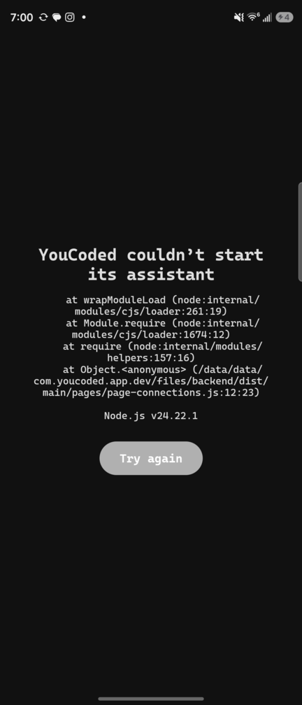

- **What a user sees:** "YouCoded couldn't start its assistant", a wall of code, and "Try again", which never works.
- **Cause:** the phone's bundled Node has no language data (ICU). One line formats the number "10,000"
  (`desktop/src/shared/pages-types.ts:184`, `toLocaleString('en-US')`) and runs at startup, so the
  backend crashes. Only the stub library `libicudata` ships; the data file `usr/share/icu/78.1/icudt78l.dat`
  is never packed (`app/runtime/build-runtime.sh`, share.tgz holds only terminfo and git-core).
- **Released 1.3.3:** we downloaded its APK and ran *its own* Node on the phone. The same command fails with the
  same "Icu error". Its backend has the same line, loaded at boot. So 1.3.1–1.3.3 Android users very likely
  can't start either. This was not run end-to-end, because 1.3.3 shares a package name with Destin's real app.
- **Proven fix** (tested on this phone; every later test ran with it): add `icu` to the share.tgz list in
  `build-runtime.sh`, and set `NODE_ICU_DATA=<files>/usr/share/icu/78.1` in `RuntimeInstaller.environment()`.
  Better still, read the folder name rather than hard-coding 78.1. Also worth a CI smoke test that starts
  the backend.

### 2. A new user's first Claude Code chat gets stuck behind a hidden setup screen
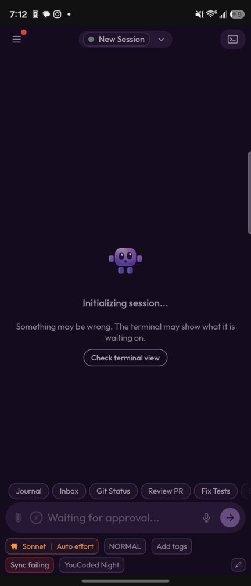 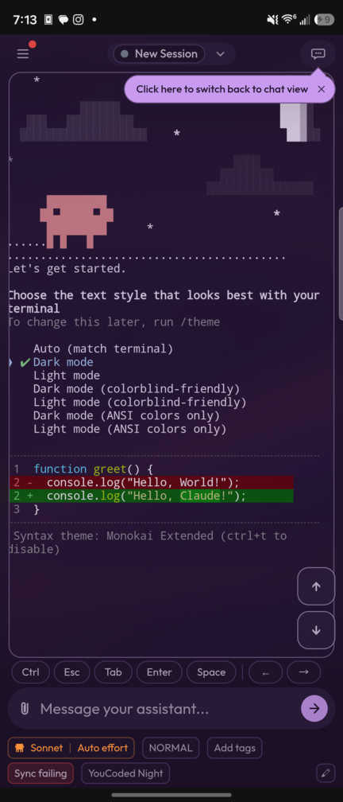

- **What a user sees:** "Initializing session… Something may be wrong" and "Waiting for approval…".
- **Cause:** Claude Code's own first-run screens wait behind the chat view: text-style picker, then
  security notes, then "Trust this folder". You only find them by switching to the terminal view and pressing
  Enter twice. The app's own sign-in does not mark Claude Code's setup as finished.
- On the computer app this was presumably handled; on the phone it isn't.

### 3. Backup & sync never works on the phone
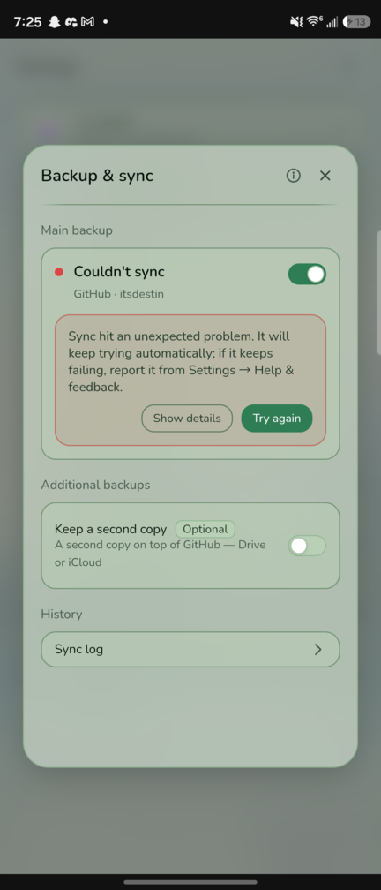

- **What a user sees:** a red **"Sync failing"** badge on every chat (even on a fresh install), and
  "Couldn't sync — unexpected problem".
- **Cause:** the phone's Git creates repos *without* the usual `info/` sub-folder (its templates folder is
  empty). The app then writes `info/exclude` without creating the folder: `ENOENT` at
  `desktop/src/main/sync-spaces/git-transport.ts:436` (and `info/attributes` at :432). Fix: `mkdirSync(info, {recursive:true})` first.

### 4. Online games are down on EVERY platform, not just Android
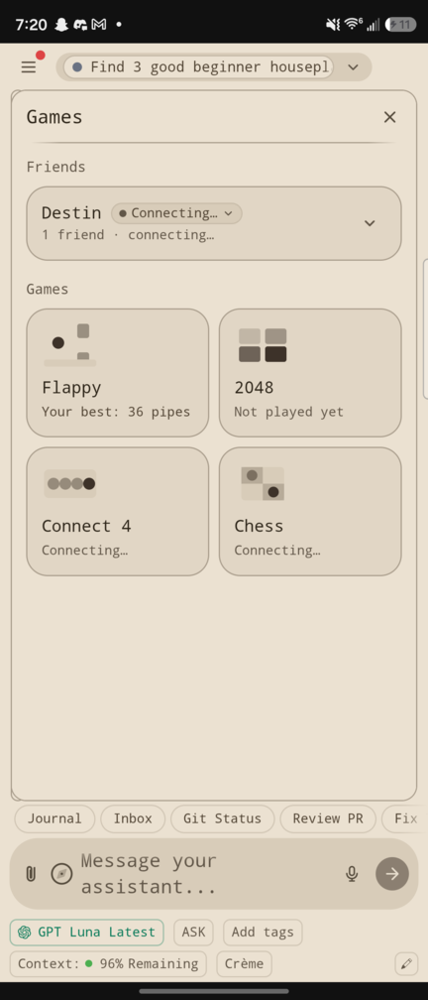

- **What a user sees:** Friends, Connect 4 and Chess stay on "Connecting…" forever.
- **Cause:** the game server address `youcoded-games.itsdestin.partykit.dev` no longer exists on the
  internet (NXDOMAIN on Cloudflare and Google DNS). Desktop will be affected the same way. No card exists for this.

### 5. Attach file does nothing on the phone

- **What a user sees:** tapping the paperclip does nothing, so a photo or document can't be added to a chat.
- **Cause:** the phone's backend answers "open file" with a stub that always returns "cancelled"
  (`desktop/src/main/headless/electron-headless.ts:135`). The phone's own file picker (MainActivity) is not
  wired to this button.

### 6. The phone app thinks it's a web browser, which explains many of the "computer" problems below

- **Cause:** in the running phone app, `window.__PLATFORM__` is `"browser"`, not `"android"`. `platform.ts`
  sets "android", but once the page signs in to its own backend, `remote-shim.ts:1566` overwrites it with
  "browser" (a rule meant for phone *web browsers* reaching a computer). So `isAndroid()` is false everywhere.
- **Effect:** the phone gets the **computer's** settings and screens: Remote-access *server* setup with
  "Install Tailscale", "Keyboard shortcuts", Local models, "Launch in new window", "Sessions in this window",
  the two-pane Pages layout, and "computer" wording. The phone's own "Connect to your computer" settings are hidden.
- **Why tests missed it:** the screenshot tools force `?platform=android`, which hides this.

---

## Problems a user will notice

| # | What happens | Where |
|---|---|---|
| 7 | **Sign-in doesn't bring you back to the app.** After Claude sign-in finishes, you're left on a "You can close this window" page in Chrome and must switch back by hand. (Destin) | First launch → Log in with Claude |
| 8 | **ChatGPT keeps saying "Waiting for the browser…"** after you back out of its sign-in and choose another method. (Destin) | Settings → Assistant settings → Cloud providers |
| 9 | **The welcome card spills off both sides of the screen:** "Start your first ses…", "roject folder", "odel", "kip permissions". The first-launch screens need a real phone layout. (Destin) 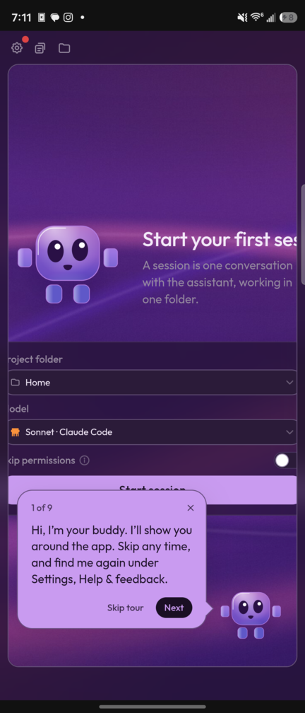 | First screen after sign-in |
| 10 | **"Computer" wording on a phone:** "Free, on this computer", "Run a model on this computer", "Checking this computer…", "a different AI… on your own computer". Should say "phone". (Destin) | First launch; Cloud providers; tour step 7 |
| 11 | **"Free, on this computer" spins forever** on "Checking this computer…". Running a model on the phone isn't available, so this choice shouldn't be offered (or should explain why). 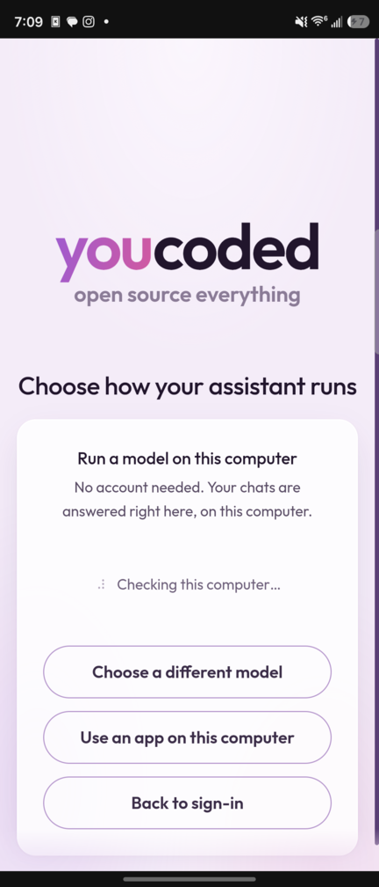 | First launch → Free option |
| 12 | **2048 can't be played:** it only listens to arrow keys/WASD; swiping does nothing. 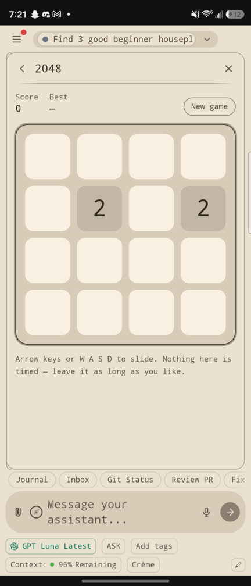 | Games → 2048 |
| 13 | **Back button with the menu open closes the whole app** instead of the menu. (Popups like Resume close correctly.) | ☰ menu |
| 14 | **No "done" notification** when a task finishes while the app is in the background. Only the permanent "Your assistant is running" shows. The work itself does finish. | Any chat, then leave the app |
| 15 | **Pages uses the computer's side-by-side layout:** the right half is a thin strip saying "No page selected". 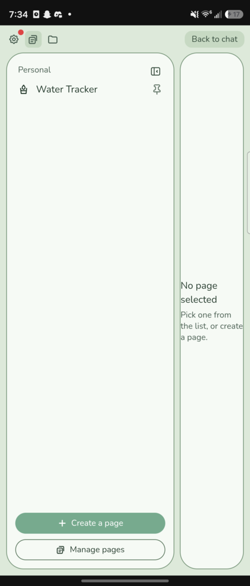 | Pages |
| 16 | **The assistant's final answer sits above a long list of ~20 steps,** so after a Page build you land on the steps and must scroll up to read "your page is ready". 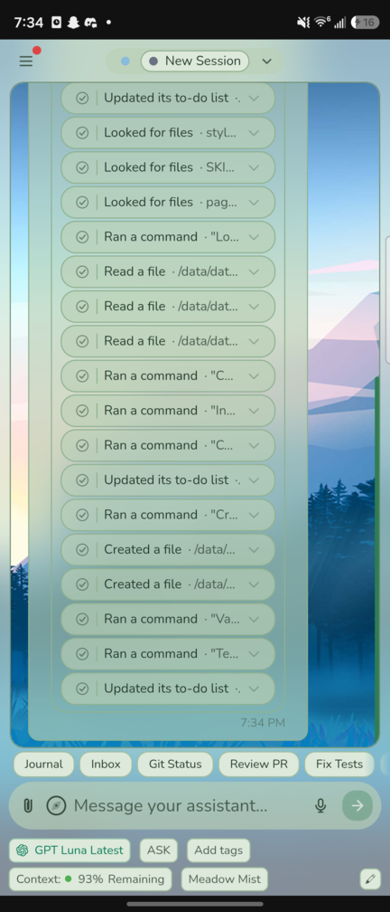 | Native chat, after a long task |
| 17 | **Permission requests are cut off:** "Running a command · "L…". You can't see what you're approving without opening it. | Native chat, Ask mode |
| 18 | **"Menu" hover label gets stuck** on screen after tapping ☰ and floats over other things, even dialogs. Same with "Switch to terminal". 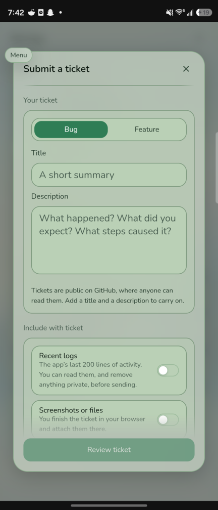 | Header buttons |
| 19 | **Keyboard pops up on its own** when opening the skills drawer and Resume, covering half the list. | Compass icon; Resume |
| 20 | **Marketplace on Android leads with Mac/Windows-only items** ("Apple Services — macOS only" is first); Themes are hidden inside Filters, off-screen in the type row, and "Browse marketplace" from Appearance doesn't open themes. No Marketplace entry in the ☰ menu. | Marketplace |
| 21 | **Tour mismatches:** it says "press Create" (button says "Start session"); its bubble covers the Start session button; it shows raw paths like `/data/data/com.youcoded.app.rel…` and app config files (providers.json) as "Project files". | First-run tour |
| 22 | **Developer shortcut chips** for everyday users: Git Status, Review PR, Fix Tests. | Above the message box |
| 23 | **Raw phone paths** in chat steps: "Created a file · /data/user/0/com.youcoded.app.dev/files/home/plants.md". | Chat step lists |
| 24 | **Keyboard-only instructions:** Flappy says "Space or Enter to flap… or press Space"; tour says "Click here". | Games; terminal hint |
| 25 | **Mode badge changed by itself** from NORMAL to AUTO after the first Claude Code message (fresh install). Worth checking whether that's intended. | Claude Code chat |
| 26 | **Checkboxes in a saved list can't be ticked** in the file viewer (the grocery list). | File viewer |
| 27 | **Startup error screen is raw:** technical text and a "Try again" that can't help; no Report bug. | Startup failure screen |
| 28 | **The page builder asked the same question twice** in its step list ("Save location" and "Location", same wording). Only one card showed; worth a look. | Native page build |
| 29 | **Notification permission is asked on a black screen** before the app has shown anything or said why. | Very first launch |

## What worked well

- Claude Code chat: replies, saves files, file chip opens the file viewer.
- Native chat (OpenRouter): web search and file write.
- Long tasks keep running with the app in the background.
- Skill install, theme install and apply (the wallpaper looks great).
- Page building, and the Page saves its data.
- Voice input listens after mic permission.
- Flappy plays with taps.
- Back closes dialogs; the Resume list loads.
- The bug report form looks right (not submitted, since tickets are public).

## Not covered

- Real sync between two devices (sync can't run at all, #3).
- Multiplayer games (server down, #4).
- Connecting the phone to a computer (that screen is hidden, #6).
- The ChatGPT sign-in itself (switched to OpenRouter).
- The cover screen of the flip phone.

## Developer notes

- **Local Android builds fail** without Alpine's `apk version -t` (the redistribution gate). CI uses Docker;
  Docker isn't usable here (socket permission). Worked around with `apk-tools-static` via
  `YOUCODED_APK_VERSION="<path>/apk.static version -t"`. `youcoded/docs/android-runtime.md` → Developing
  doesn't mention this.
- **The flip phone has two displays:** `adb exec-out screencap -p -d 4633128672291735937` is the inner screen.
- The ICU test patch used for this run is not committed; its exact change is in #1 above.
